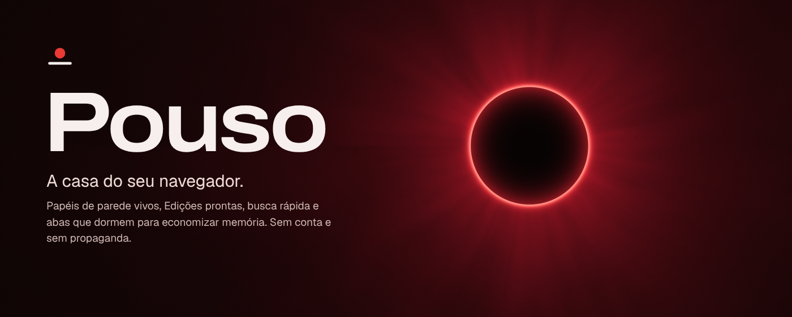
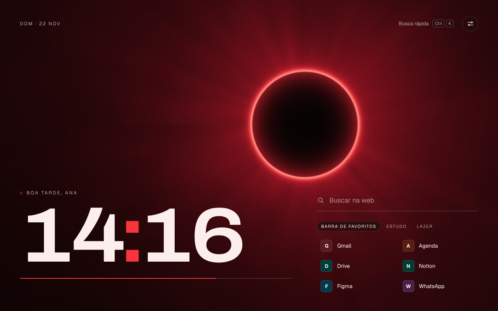
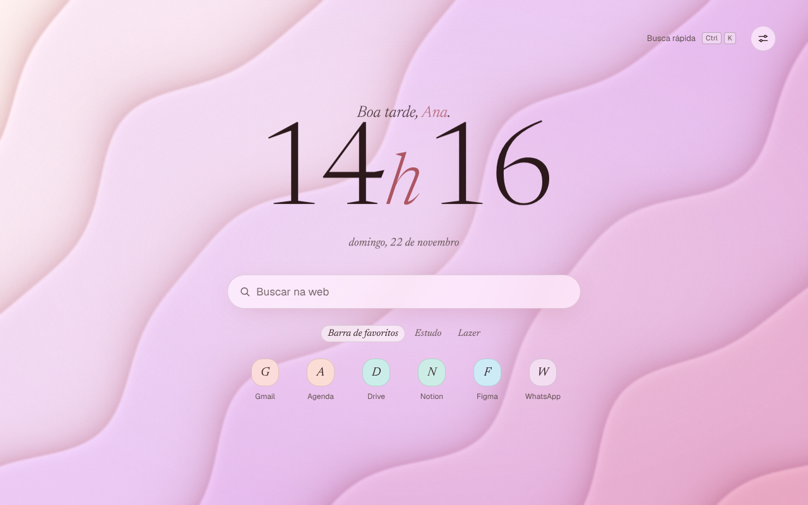
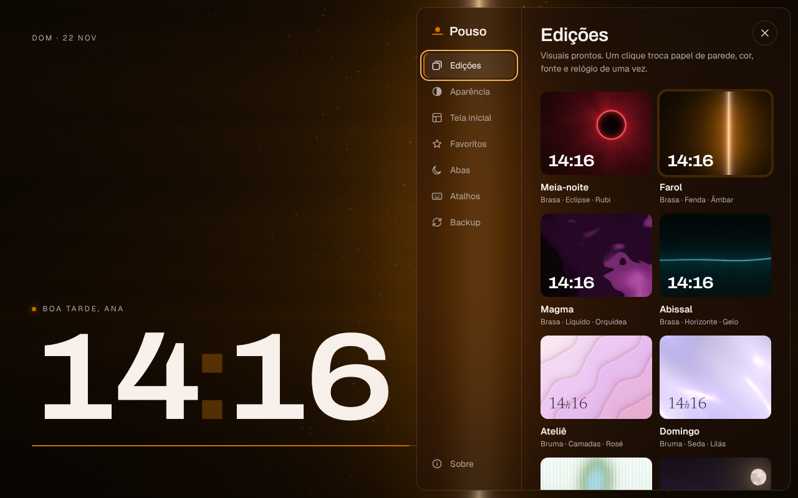
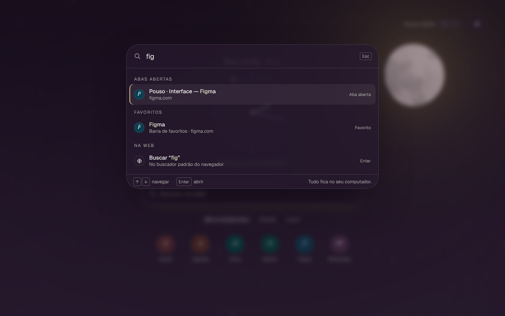
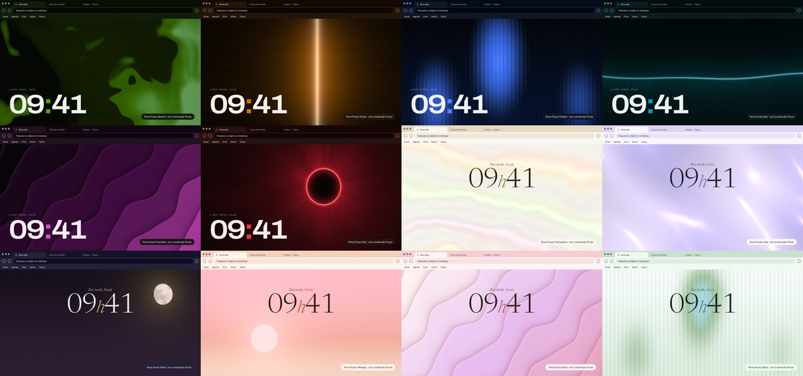

# Pouso

**A casa do seu navegador: única, bonita e leve.** Extensão de nova aba para Chrome e Edge: papel de parede vivo, relógio, seus favoritos e uma busca que acha qualquer coisa, num visual que você monta em um clique.

Grátis, de código aberto, sem cadastro e sem propaganda: nada sai do seu computador.

<p align="center"></p>

<p align="center">
  
  
</p>

## O que tem

- **Dois estilos.** **Brasa**: escuro, uma luz forte num ponto, movimento que pulsa. **Bruma**: claro e suave, serifa elegante, movimento que flutua, com modo Noite.
- **Edições.** Oito visuais prontos (Meia-noite, Farol, Magma, Abissal, Ateliê, Domingo, Estufa, Vigília) que trocam papel de parede, cor, fonte e relógio de uma vez.
- **12 papéis de parede vivos**, desenhados em tempo real: vidro canelado, líquido, camadas de papel, eclipse, fenda de luz, horizonte, seda, pérola, entardecer e uma Lua com a fase de hoje.
- **Cores que se ajeitam sozinhas.** Escolha uma cor (ou qualquer uma no seletor livre) e ela gera a paleta inteira, com contraste conferido para ler bem.
- **Disposição sem arrastar nada.** Relógio no **Centro**, no **Canto** ou em **Coluna**, com quanto mostrar: mínima, normal ou completa.
- **Seus favoritos de sempre** na tela, com as pastas virando grupos. Sem outro cadastro.
- **Busca rápida.** <kbd>Ctrl</kbd> + <kbd>K</kbd> na nova aba, ou <kbd>Alt</kbd> + <kbd>K</kbd> em qualquer site: abas abertas, favoritos, histórico e comandos.
- **Abas que dormem.** Abas paradas devolvem memória depois de 30 minutos (você escolhe o tempo). Fixadas e as que tocam som nunca dormem, e dá para listar sites que ficam sempre acordados.
- **Sessões.** Salve as abas de uma janela e reabra quando quiser.
- **Combine o navegador.** 12 temas companheiros deixam abas e barra na mesma cor da sua nova aba.
- **Português e inglês**, conforme o idioma do navegador.

<p align="center">
  
  
</p>

## Instalar

**Pela loja (recomendado):** Chrome Web Store e Edge Add-ons, assim que a revisão terminar. Os links entram aqui.

**Agora, pelo GitHub:**

1. Baixe `pouso-1.0.0.zip` em [Releases](../../releases/latest) e descompacte numa pasta fixa, por exemplo `Documentos/pouso`. Não apague essa pasta depois.
2. No Chrome, abra `chrome://extensions` e ligue o **Modo do desenvolvedor** (canto de cima, à direita). No Edge: `edge://extensions` › **Modo de desenvolvedor**.
3. Clique em **Carregar sem compactação** e escolha a pasta que tem o arquivo `manifest.json`.
4. Abra uma aba nova. Se o Chrome perguntar se quer manter a alteração, clique em **Manter**: é o próprio Chrome confirmando que o Pouso pode cuidar da nova aba.

Funciona no Chrome, Edge, Brave e outros navegadores com base no Chromium (versão 121 ou mais nova).

## Como usar

1. Na primeira abertura, escolha o **clima** (Brasa ou Bruma), o **papel de parede** e, se quiser, **combine o Chrome**.
2. <kbd>Ctrl</kbd> + <kbd>,</kbd> ou o botão de ajustes abre o painel: **Edições**, **Aparência**, **Tela inicial**, **Favoritos**, **Abas**, **Atalhos**, **Backup** e **Sobre**.
3. **Backup:** todo o seu visual cabe num código `POUSO-…`. Copie, guarde, mande para um amigo ou cole em outro computador.

| Atalho | O que faz |
|---|---|
| <kbd>Ctrl</kbd> + <kbd>K</kbd> | busca rápida na nova aba |
| <kbd>Alt</kbd> + <kbd>K</kbd> | busca rápida em qualquer site |
| <kbd>Ctrl</kbd> + <kbd>,</kbd> | abre e fecha os ajustes |
| <kbd>/</kbd> | vai para a busca na web |
| <kbd>Esc</kbd> | fecha o que estiver aberto |

<p align="center"></p>

## Leve de verdade

- **Abre na hora.** A aba nasce com uma foto do último papel de parede e a animação entra depois do primeiro quadro.
- **Não esquenta o notebook.** Papel a 30 quadros por segundo, em resolução reduzida, um de cada vez. Para quando a aba sai da tela e respeita o "reduzir movimento" do sistema. Se o computador sofrer, a resolução baixa sozinha.
- **Sem nada de fora.** Fontes, código e imagens vêm dentro do pacote: abrir uma aba não faz nenhum pedido à internet.

## Perguntas

**É grátis mesmo?** Sim. Sem conta, sem plano pago, sem propaganda.

**Por que ele pede permissão de favoritos, abas ou histórico?** Só quando você liga o recurso que precisa dela: mostrar favoritos na tela, buscar com <kbd>Ctrl</kbd> + <kbd>K</kbd> nas suas abas e histórico, salvar sessões. Sem ligar, o Pouso funciona e a instalação quase não mostra aviso.

**Meus dados vão para algum lugar?** Não. Veja [PRIVACY.md](PRIVACY.md).

**Os papéis de parede estão no código?** Os 12 papéis animados vêm só no pacote da loja e no zip de [Releases](../../releases/latest). Aqui no código aberto, `src/shaders.js` traz uma versão simples com a mesma interface, para o projeto montar e rodar.

**Achei um problema.** Abra uma [issue](../../issues) com um print e a versão do navegador.

## ☕ Apoie


O Pouso é grátis. Se ele deixou seu navegador mais bonito, pague um café pro dev, no Pix, valor livre.

Chave Pix: `contato@zarpadev.com.br`

Pix copia e cola:

```
00020126450014br.gov.bcb.pix0123contato@zarpadev.com.br5204000053039865802BR5911KAUA PESSIN6007VITORIA62070503***6304A70B
```

## Feito pela Zarpa

Precisa de site, sistema ou automação sob medida? A **Zarpa Dev** faz, do jeito que este Pouso foi feito.
[zarpadev.com.br](https://zarpadev.com.br/?utm_source=pouso) · Instagram [@zarpa.dev](https://www.instagram.com/zarpa.dev/) · feito por Kauã, [@pessinkauaa](https://www.instagram.com/pessinkauaa/)

## Para desenvolvedores

Manifest V3, JavaScript puro, sem framework e sem dependências na extensão. Um código só para Chrome e Edge.

```
src/index.html      nova aba (vira newtab.html na montagem)
src/boot.js         primeiro quadro: repete o visual da última aba antes de tudo
src/app.js          interface: primeira abertura, painel, Edições, disposição, sessões
src/palette.js      motor de cor OKLCH com contraste garantido (WCAG)
src/shaders.js      papéis de parede (versão aberta simples; os 12 originais vão no pacote da loja)
src/renderer.js     WebGL leve: 30 quadros/s, resolução reduzida, pausa fora da tela
src/platform.js     ponte com o navegador (favoritos, abas, histórico, busca, permissões opcionais)
src/quick.js        busca rápida (Ctrl+K e o popup do Alt+K)
src/i18n.js         português e inglês
src/background.js   service worker: abas paradas dormem (tabs.discard)
ext-static/         manifest, ícones e textos da loja
fonts/              Archivo, Newsreader e Geist (SIL OFL)
temas/              gera os 12 temas companheiros e as imagens da loja
docs/               política de privacidade (GitHub Pages)
tests/e2e.py        carrega a extensão num Chromium e confere a nova aba
```

```
python build.py          # monta dist/extensao e dist/pouso-prototipo.html
python tests/e2e.py      # teste de ponta a ponta (precisa de: pip install playwright)
node temas/cores.js      # cores dos 12 temas a partir das mesmas paletas da extensão
```

Permissões obrigatórias: `storage`, `search`, `alarms`, `favicon`. Opcionais, pedidas no clique: `bookmarks`, `tabs`, `history`.

Pull requests são bem-vindos. Código sob [GPL-3.0](LICENSE); as fontes sob a [SIL Open Font License](fonts/OFL.txt). Os papéis de parede animados e a marca Pouso não estão incluídos na licença. Não é afiliado ao Google nem à Microsoft.

---

### English

**Pouso is a home for your browser: unique, beautiful and light.** A new tab extension for Chrome and Edge with two styles (Brasa and Bruma), eight one-click Editions, 12 living wallpapers, OKLCH color palettes with checked contrast, three layouts (Center, Corner, Column), your existing bookmarks, quick search (<kbd>Ctrl</kbd> + <kbd>K</kbd> on the new tab, <kbd>Alt</kbd> + <kbd>K</kbd> anywhere), sleeping tabs, saved sessions and 12 matching browser themes. No account, no tracking, no ads. Install from [Releases](../../releases/latest): unzip, open `chrome://extensions`, turn on Developer mode, Load unpacked. Code under GPL-3.0, made by [Zarpa](https://zarpadev.com.br/?utm_source=pouso).
